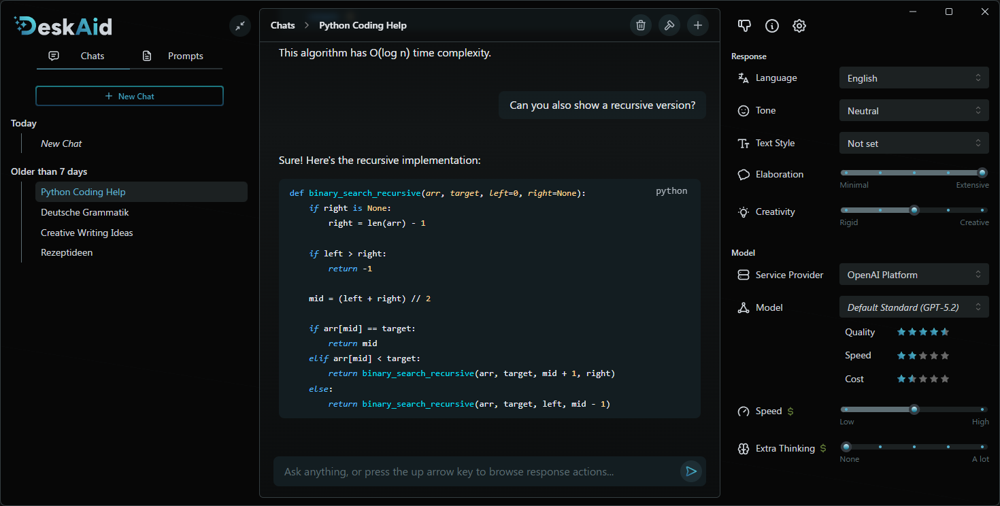

    

## Description
This is the public repository of DeskAid that contains the official releases of the DeskAid AI automation software. DeskAid is an application designed to assist with various tasks while working on a desktop pc (currently only available for Windows, with macOS and Linux support planned) by leveraging the power of AI. At present, it enables you to create prompts using arbeitrary LLM providers that support the OpenAI Chat Completions API. DeskAid can be used in any program that supports copying and pasting text via Ctrl+C / Ctrl+V and is activated by global hotkeys (see Usage). This ensures DeskAid is always instantly accessible when you need it, minimizing disruption to your workflow.

## Download Windows Installer
<a href="https://github.com/DeskAid/DeskAid/releases/latest/download/deskAId-Setup.exe">Download here</a>

## Screenshot

    

## Usage
You can change the hotkeys in the settings and per prompt. The hotkeys are blocked for other programs until DeskAid is closed.

The following hotkeys are registered globally at program start by default:
- F2: Show the actions menu
- F3: Show the main menu

### Workflow
You can either use the menu or the hotkeys to call your prompt. When using the menu you just need to remember one hotkey (F2 by default).

## Upcoming features
- Using context from files, images...
- Creating Python scripts for even more automization possibilities
- Light mode and more customizations
- Support for macOS and Linux
